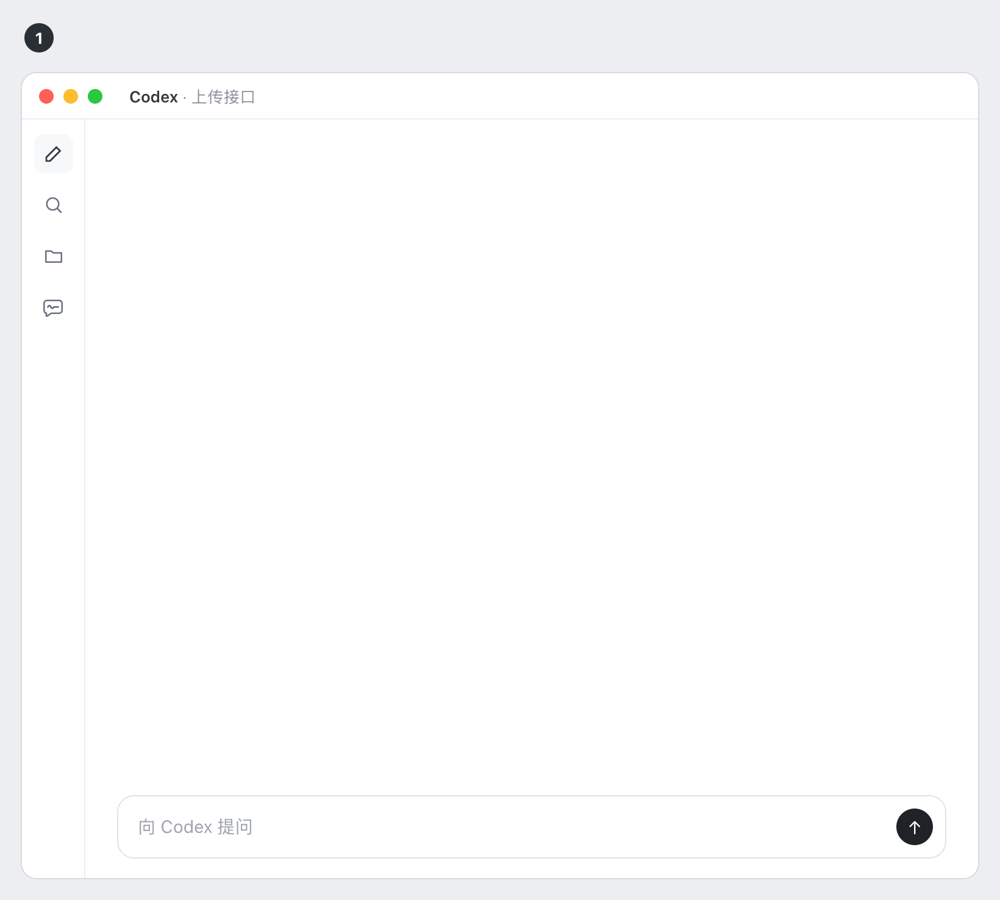
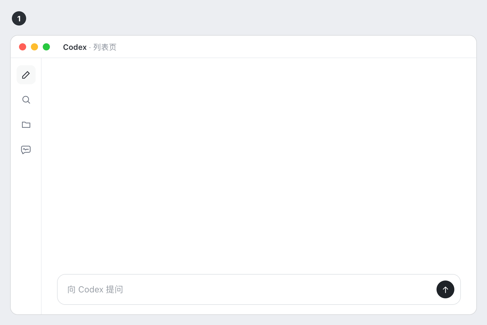

<p align="center"></p>

<h1 align="center">ihatejargons</h1>

<p align="center">把 Codex 的回复讲成人话。<br>一个 <a href="https://github.com/codex-tweaks/codex-tweaks">Codex Tweaks</a> 功能包，在 Codex Desktop 每条回复上方加一排阅读按钮。</p>

---

Codex 的汇报经常这样写：「重试这块已经收口并落到主分支，防重键钉死在文件维度，上线前还要和 CDN 接线、把回滚哨兵的口径对齐」。每个字都认识，合起来不知道做完了没有、还差什么、要不要你拍板。

ihatejargons 不改动原回复，只在它上方加几个按钮，让你换一种读法：

| 按钮 | 读到什么 |
|---|---|
| **原文注释** | 原文不动，看不懂的术语加上虚线。点一下，看它在这句话里具体指什么，还可以接着追问。 |
| **简明改写**（默认） | 逐句改成白话，顺序、表格和信息量都保留。适合想看全部细节的时候。 |
| **讲给外行** | 重新组织成一条短消息：现在是什么状态、为什么、接下来要不要你做什么。 |

改写只依据原文：做完的、计划中的、只是猜测的事，都按原文的状态写，不会替 Codex 回答你没得到答案的问题。

## 效果

**上传接口的重试逻辑**：先在原文里点开虚线词。同一个「收」字，「收口」解释成已经做完，「再收」解释成留到下一轮再修。接着追问一句，再依次切到简明改写、讲给外行。

<p align="center"></p>

**列表页接后端**：「状态投影」「回包」「真回包」都按这段对话解释。讲给外行开头直接说出结论：列表页现在用的还是假数据。

<p align="center"></p>

两段回复取自评测集（`banned-words`、`wire-projection`），注释、追问回答和改写都是插件用默认模型实际生成的。窗口是按 Codex Desktop 重画的示意，黄色高亮只是为了在动图里标出难懂的词，插件本身不会加。

## 安装

1. 安装 [Codex Tweaks](https://github.com/codex-tweaks/codex-tweaks)。
2. 在 Codex Tweaks 的「功能包 → 从 Git 安装」里填入 `https://github.com/sssn-tech/ihatejargons`。
3. 启用功能包，并确认它申请的 Node 权限。插件需要 Node 后端来调用模型、读取本机聊天记录和保存缓存，具体见下面的[数据去向](#数据去向)。

## 设置

点 Codex 左侧图标栏里的 ihatejargons 图标（一个带波浪线的对话气泡），或者从「设置 → ihatejargons」进入设置页。修改后点底部的「保存」才会生效；「撤销修改」会回到上次保存的状态。

**翻译服务**二选一：

- **硅基流动**（默认）：默认模型是 `deepseek-ai/DeepSeek-V4.1-Flash`，也可以填硅基流动上的其他模型名。在设置页粘贴 [API 密钥](https://cloud.siliconflow.cn/account/ak) 并点「保存密钥」。密钥单独保存在插件数据目录（权限 600），之后页面上只显示末四位。如果没在设置页填，插件依次读取环境变量 `SILICONFLOW_API_KEY` 和 `~/.config/minicode/siliconflow.env`。
- **本机 Ollama**：填一个已经下载好的模型名，例如 `qwen3:8b`。插件连接 `127.0.0.1:11434`，正文不会离开这台电脑。

填好以后点「测试连接」，插件会用当前填写的设置（不必先保存）发一条很短的请求，显示是否连通、耗时多少。

**阅读档位**：左侧是按钮列表，右侧编辑选中的那一档。每一档都可以改名、改提示词和输出格式，选择「保留原文的表格和结构」或「可以重新组织」，设为默认显示，或加入后台预翻译。可以添加自己的档位（最多 16 个）并调整顺序。改过的内置档位会标「已修改」，随时可以「恢复内置提示词」。插件升级内置提示词时，你没改过的档位会自动换成新版；改过的、自己建的档位不受影响。

**预翻译与缓存**和**高级**里的选项见下一节。

## 预翻译与缓存

译文缓存在本机，再次打开同一条回复时直接显示，不再调用模型。

- **缓存上限**默认 32 MiB，可设 0–2048 MiB。超出后先淘汰最久没用过的译文。设为 0 时不保存译文，自动预翻译也会停用。
- **自动预翻译**默认开启：插件启动时和之后每分钟，检查最近 3 个聊天，把每个聊天最近 4 条回复按「简明改写」先翻译好。打开「也包括还没打开过的本机聊天」后，会从本机 Codex 会话文件里读取尚未打开的聊天。
- 每条回复上方的「重新生成」只重做当前这一档；左侧聊天列表的标记可以对单个聊天预翻译、重新翻译或删除缓存（见下表）。设置页的「清空译文缓存」需要点两次确认。
- 插件更新后，旧缓存会自动失效。
- **高级**里可以调同时翻译的条数（默认 4）和术语注释的并发请求数（默认 2）。正在阅读的回复总是排在预翻译前面。

使用硅基流动时，预翻译会产生模型调用费用。只想看自己点开的回复，就关掉「自动预翻译最近的聊天」。

### 聊天列表上的标记

| 标记 | 含义 |
|---|---|
| ○ | 还没翻译 |
| ◷ / ◐ | 排队中 / 正在翻译 |
| ◒ | 部分回复已有译文 |
| ✓ | 设定范围内的回复都已翻译 |
| ! | 预翻译失败，可以从菜单重试 |

点标记可以看进度，并对这一个聊天操作，不用切换过去。删除某个聊天的缓存后，它不再参与自动预翻译，直到你从它的菜单重新开始。

## 数据去向

| 什么 | 发给谁 | 什么时候 |
|---|---|---|
| 要改写的回复、你这一轮的提问（最多 6000 字）、之前最多 12 条对话（合计最多 8000 字） | 你选的翻译服务 | 打开一条回复，或预翻译时 |
| 当前回复里的一段文字 | 你选的翻译服务 | 给术语加注释时 |
| 某个术语所在的原句、它的释义、你的追问和最近六轮问答 | **硅基流动 DeepSeek V4.1 Flash**（选了 Ollama 也一样） | 你在术语解释窗里追问时 |
| 本机 Codex 会话索引和会话文件 | 不发出，只在本机读取 | 预翻译尚未打开的聊天时 |

预翻译只读取已经结束的轮次里你的文字、助手回复和公开的推理摘要；工具输出、附件内容和内部推理都不读取。

保存在本机插件数据目录里的有：设置、API 密钥（如果你在设置页填了）、有容量上限的译文缓存。术语释义和追问记录只保存在内存里，关掉回复就没了。

## 兼容性与已知限制

- 在 macOS 版 Codex Desktop 26.1120.50957 和 Codex Tweaks 3.5.12 上测试过。插件靠页面结构找到回复，其中有一处依赖带哈希的样式名，Codex Desktop 更新后可能失效，届时需要更新插件。
- 译文只输出简体中文；英文回复也会译成中文。
- 选了本机 Ollama 时，术语追问仍然走硅基流动（见上表），需要有硅基流动密钥才能用。
- 改写由模型完成，偶尔仍会出错。拿不准的时候，点「原文注释」对照原文。

## 开发

```bash
node --test test/*.test.mjs eval/lib.test.mjs   # 单元测试，不调用模型
node eval/run.mjs                               # 在评测集上跑两档改写，会调用硅基流动
```

改提示词前后各跑一次 `eval/run.mjs`，再用 `eval/review.mjs` 生成新旧对照页。评测集的用例来源和评分方式见 [eval/README.md](eval/README.md)。

插件只把 `package.json` 和 `src/` 算进构建哈希，改 `eval/`、文档或测试不会让用户的缓存失效。

## 许可

随包附带的 Markdown 渲染组件 markdown-it 使用 MIT 许可（`src/vendor/markdown-it.LICENSE`）。评测集里取自 shuorenhua 的用例和词表使用 MIT 许可（`eval/licenses/`）。
